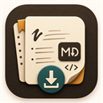

<div align="center">

# Get2MD



**把得到大脑笔记的原文或 AI 总结导出为 Markdown。**

[](#本地运行)
[](#隐私)
[](LICENSE)

[下载源码 ZIP](https://github.com/Raymond-Hear/Getbiji2md/archive/refs/heads/main.zip) · [开始使用](#开始使用) · [导出文件](#导出文件) · [反馈问题](https://github.com/Raymond-Hear/Getbiji2md/issues)

</div>

## 它能做什么

想给读书笔记留一份本地备份？同步得到大脑后，选中对应知识库，按标签、笔记类型、日期或关键词找出需要的内容。点开笔记，可以先看原文、图片和已有的 AI 总结。

单篇直接下载为 Markdown。勾选多篇后，可以批量下载原文或 AI 总结，得到一个装有独立 Markdown 文件的 ZIP 包。解压后可放进本地文件夹，或导入支持 Markdown 的笔记工具。

## 开始使用

1. 下载并解压源码，双击 `index.html`，再点「打开导出工具」。也可以通过下方的 [本地运行](#本地运行) 启动。
2. 用得到大脑会员账号进入开放平台，获取 `API Key` 和 `Client ID`。 [得到大脑开放平台](https://www.biji.com/openapi?tab=clients) · [官方说明](https://doc.biji.com/docs/AGhfwzioqiHbv4kbObjcuStnnBg)
3. 在工具页点「开始设置」，填入并保存两项凭证，再点「同步笔记」。首批笔记出现后就可以筛选和预览。
4. 打开单篇，或勾选多篇。点击「下载原文」或「下载 AI 总结」。

### 同步选项

| 操作 | 适合什么时候用 |
| --- | --- |
| 同步笔记 | 第一次读取历史笔记。 |
| 继续同步 | 暂停或关闭页面后，从当前浏览器保存的进度接着读取。 |
| 检查最近更新 | 读取近期新增或修改的笔记。 |
| 完整重新同步 | 重新核对全部历史笔记和删除记录。 |

工具会在接口限流时等待后重试。额度耗尽时会暂停并保存进度。更多细节见 [同步与筛选说明](docs/SYNC-AND-TYPE-FILTERS.md)。

## 导出文件

| 选择 | 下载结果 |
| --- | --- |
| 一篇笔记 | 一个 `.md` 文件 |
| 多篇笔记 | 一个 `.zip` 压缩包，每篇对应一个 `.md` 文件 |

Markdown 包括笔记标题、日期、类型、标签和归属知识库，以及你选择的原文或 AI 总结。图文笔记会尽量保留原图链接，查看时需要能访问原地址。

## 隐私

浏览器直接向得到大脑开放平台请求笔记。连接凭证、已读取的笔记和同步进度保存在当前浏览器。你可以在工具页的「连接设置」中清除本地配置和笔记缓存。

`API Key` 和 `Client ID` 都是敏感信息。公开反馈时，请遮盖凭证并移除私人笔记内容。

## 本地运行

项目是静态网页。解压后可以用浏览器打开 `index.html`，也可以在项目目录用 Node.js 启动本地服务。

```sh
node tests/preview-server.cjs
```

启动后，在浏览器打开 `http://127.0.0.1:8766/`。如果要自行部署，可以把项目放到支持静态网页的托管服务。

同步与筛选测试可以用以下命令运行。

```sh
node --test tests/sync.test.cjs
```

## 关于作者

Get2MD 由 [聆风 Raymond](https://github.com/Raymond-Hear) 维护，采用 [MIT 许可证](LICENSE) 开源。
